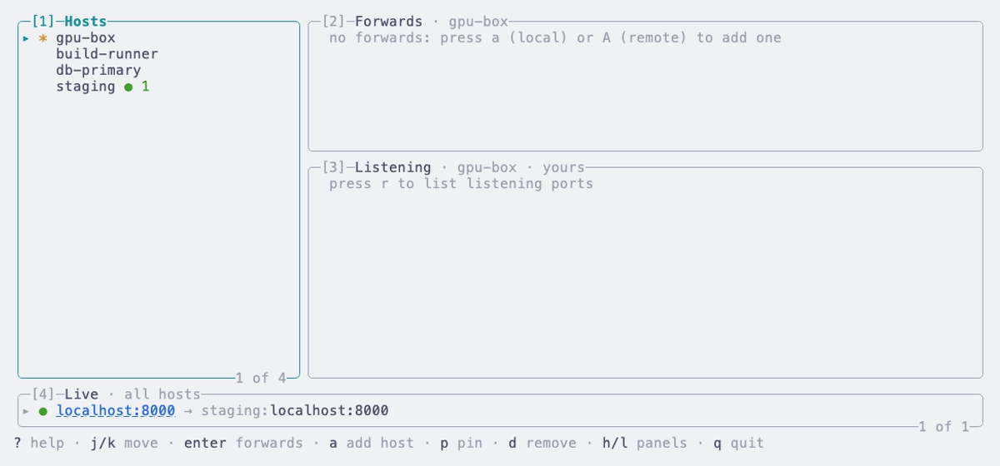

# lazyfwd

lazyfwd manages SSH port forwards from a keyboard-first terminal UI, in the spirit of lazygit. Pick a host, find a listening port, and forward it to your machine without remembering SSH flags.

For example, if a web app runs on port 3000 on a remote host, you can select that port, press `space`, and open it in your local browser. lazyfwd uses your system `ssh`, so your SSH config, agent, and ProxyJump work as usual.

## Terminal UI

<picture>
  <source media="(prefers-color-scheme: dark)" srcset=".github/assets/demo-dark.gif">
  
</picture>

Hosts comes from your SSH config, and you can add or pin hosts. Forwards shows the selected host's saved forwards. Listening shows its listening ports and process names when available. Live shows running and failed forwards across hosts.

## Install

You need `ssh` on your `PATH`. lazyfwd runs on Linux, macOS, WSL, and Windows. See [Windows](#windows) for its limitations.

On Linux, macOS, and WSL:

```sh
curl -fsSL https://github.com/glattziehen/lazyfwd/releases/latest/download/install.sh | sh
```

It installs the latest release to `~/.local/bin` after checking its checksum. Set `LAZYFWD_INSTALL_DIR` to change that, or `LAZYFWD_VERSION=v0.1.1` to pin a release. On Windows, from PowerShell:

```powershell
irm https://github.com/glattziehen/lazyfwd/releases/latest/download/install.ps1 | iex
```

It installs to `%LOCALAPPDATA%\Programs\lazyfwd` and adds that to your user `PATH`. Set `LAZYFWD_NO_MODIFY_PATH` to keep the `PATH` as it is.

Run the same command again to update.

You can also download an archive for your system from the [releases page](https://github.com/glattziehen/lazyfwd/releases), check it against `checksums.txt`, and put `lazyfwd` on your `PATH`. If Gatekeeper blocks a browser download on macOS, run `xattr -d com.apple.quarantine lazyfwd`.

Or install with Go 1.24 or later:

```sh
go install github.com/glattziehen/lazyfwd@latest
```

To build from source:

```sh
git clone https://github.com/glattziehen/lazyfwd.git
cd lazyfwd
go build .
```

This writes `./lazyfwd`. To enable the contributor hooks, run `pixi run lefthook-install` once.

## Use the terminal UI

Run `lazyfwd`, then:

1. In Hosts, select a host with `j` and `k` and press `enter`. If it isn't listed, press `a` to add it.
2. Press `tab` to reach Listening. Press `r` to refresh the ports, select one, and press `space` to forward it to your machine.
3. Press `o` to open the forward's local end in your browser. Supported terminals also make web ports clickable.

The four panels stack in a column on the left, and a Details pane on the right describes the selected host, forward, or port. Use `h` and `l` (or `tab`) to step up and down the column, or `1` through `4` to jump to a panel. In Forwards, press `a` to add a local forward by hand, `A` to add a remote forward, or `space` to start or stop a forward. You can forward TCP ports and Unix sockets in either direction (`-L` or `-R`). Press `?` for all keys.

By default, lazyfwd keeps the same local port as the remote port, or uses the nearest free one. Forwards stop when you quit and return stopped the next time you run lazyfwd. Hosts, pins, and forwards are saved in `$XDG_CONFIG_HOME/lazyfwd/workspace.json` (`~/.config` on Linux, `~/Library/Application Support` on macOS, `%AppData%` on Windows).

If SSH needs a password, host key confirmation, or another login step, lazyfwd hands the terminal to SSH and returns after it connects.

## Use the command line

Scripts and agents can use commands alongside the UI. Commands go through the running lazyfwd process, so the UI shows their changes at once. Without the UI, run `lazyfwd serve` to hold the connections:

```sh
lazyfwd serve &
lazyfwd forward add box 4966-4968 --start   # Forward remote ports to the same local ports
lazyfwd forward list --json
```

Forwards stop when `serve` exits. Commands that only list or change saved hosts and forwards also work without a running UI or `serve`. Run `lazyfwd --help` for commands, JSON output, and exit codes.

## Windows

The SSH that Windows ships cannot share one connection per host, so each forward runs its own SSH. lazyfwd refuses:

- Hosts that ask for a password, key passphrase, or 2FA on every connect. Use a key that SSH can use without asking, such as one in `ssh-agent`.
- Hosts whose SSH config has `LocalForward`, `RemoteForward`, or `DynamicForward` lines.
- Unix sockets as a forward's local end. Sockets on the remote host work.

When a host's key is unknown, lazyfwd hands the terminal to SSH so you can accept it.

CI tests Windows Server 2025 against a Linux SSH server. The tests cover forwards in both directions, sockets on the remote host, the command line and `lazyfwd serve`, and SSH cleanup after lazyfwd quits or crashes. The terminal UI in a real console, opening a browser, and host key login are not tested on Windows.
